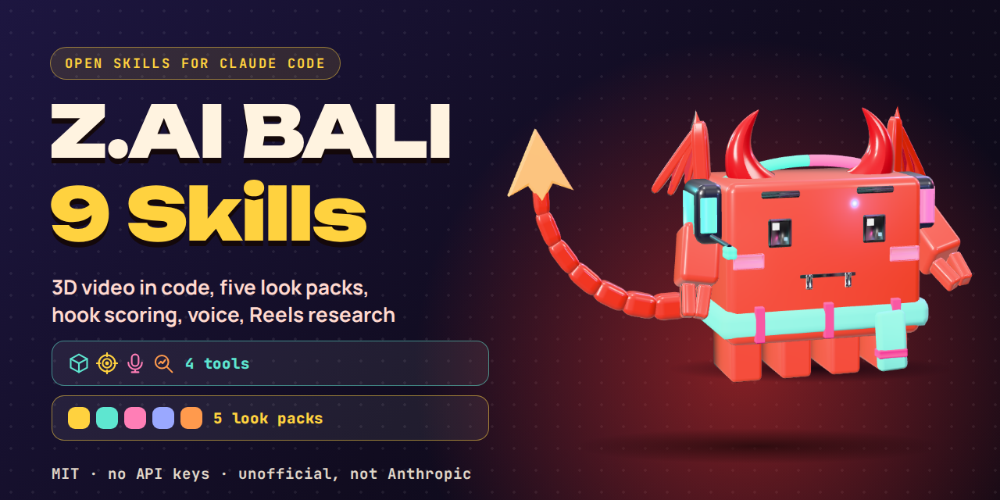
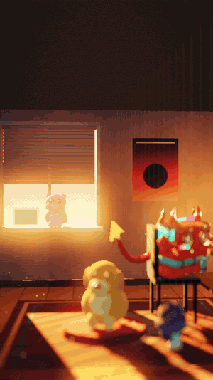
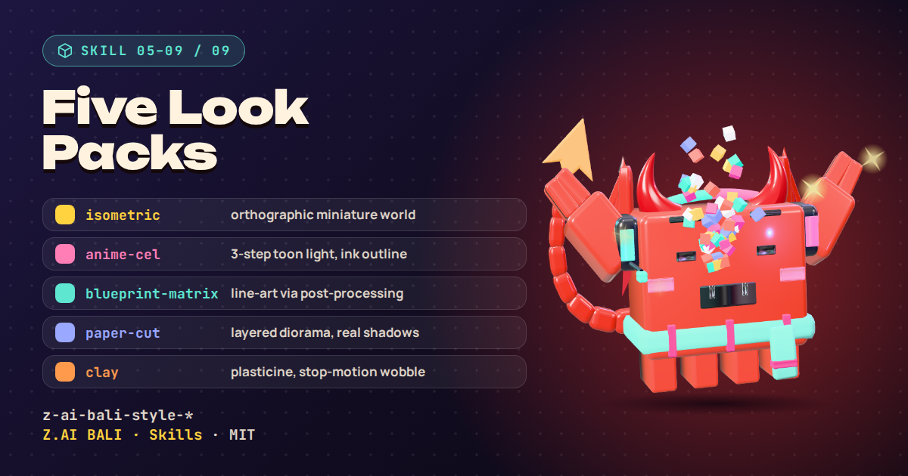
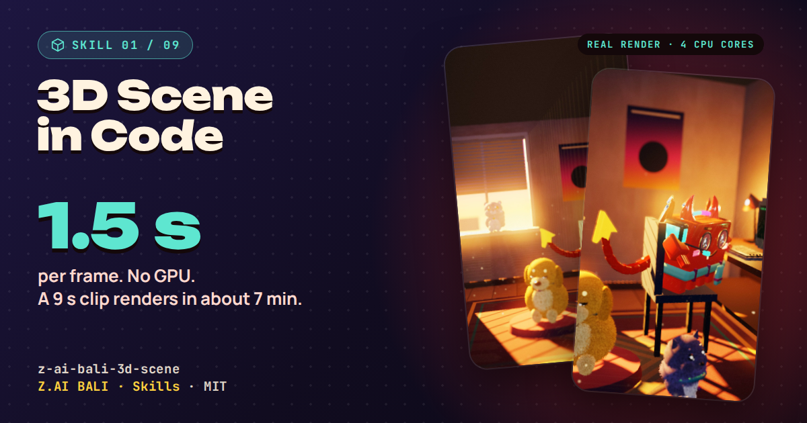
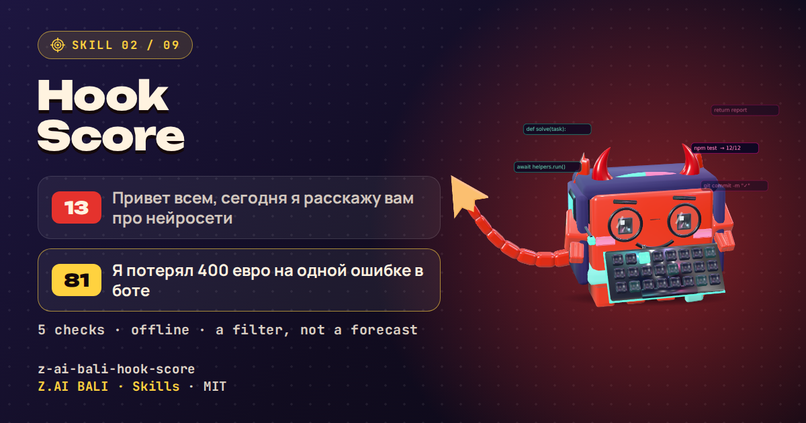
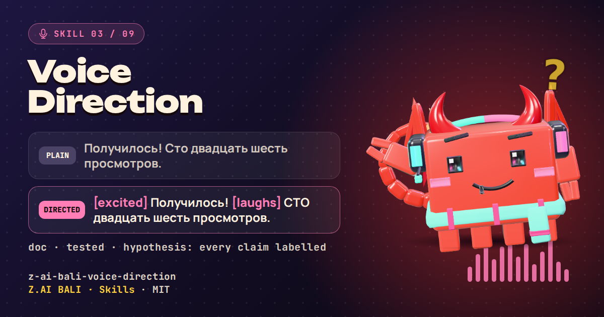
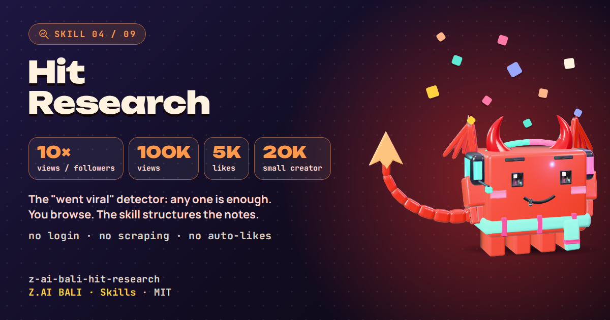

<p align="center">
  
</p>

<p align="center">
  <b>9 open skills for Claude Code: 3D video in code, five look packs, hook scoring, voice direction, Reels research.</b><br>
  Extracted from the workflow behind our own Reels.
</p>

<p align="center">
  <a href="LICENSE"></a>
  
  
  
</p>

<p align="center"><br><sub>A real render from <code>z-ai-bali-3d-scene</code>: three.js in headless Chromium, no GPU, camera path, light, dust, depth of field. 7 seconds, 3 MB.</sub></p>

<p align="center">
<!-- STATS:START -->
⭐ Stars: <b>0</b> · 🍴 Forks: <b>0</b> · 🧩 Skills: <b>9</b> · 📝 Commits: <b>5</b> · 🕒 Last updated: <b>2026-11-10</b> (UTC)
<!-- STATS:END -->
</p>

## Install (two lines)

```text
/plugin marketplace add zaibalistudio/zai-bali-skills
/plugin install zai-bali@zai-bali-skills
```

Manual install: copy any `skills/z-ai-bali-*` folder into `~/.claude/skills/`.

> **Unofficial.** Not affiliated with, endorsed by, or sponsored by Anthropic, Meta or ElevenLabs. "Claude" is a trademark of Anthropic; Instagram is a Meta product.

## What's inside

| Skill | What it does, and what to say |
|---|---|
| 🧊 [`z-ai-bali-3d-scene`](skills/z-ai-bali-3d-scene/SKILL.md) | Cinematic 3D room or object video with three.js in headless Chromium (no GPU), a camera path, light, dust, DOF, bloom and synthesized sound<br><sub>Say: "make a 3D clip of a cosy desk", «сделай 3D-ролик»</sub> |
| 🎯 [`z-ai-bali-hook-score`](skills/z-ai-bali-hook-score/SKILL.md) | Offline scorer for Russian Reel hooks on 5 checks, plus 26 rewrite formulas. A filter for weak hooks, not a view predictor<br><sub>Say: "score these hooks", «оцени хук»</sub> |
| 🎙️ [`z-ai-bali-voice-direction`](skills/z-ai-bali-voice-direction/SKILL.md) | Emotion tags, pauses, emphasis and settings for ElevenLabs-style voice acting; every claim marked doc / tested / hypothesis<br><sub>Say: "make this line sound alive", «оживи реплику»</sub> |
| 📡 [`z-ai-bali-hit-research`](skills/z-ai-bali-hit-research/SKILL.md) | Structured research of viral short videos in your own browser at human speed: detector, hit card, weekly summary. No login, no scraping<br><sub>Say: "break down this hit", «разбери хит»</sub> |
| 📐 [`z-ai-bali-style-isometric`](skills/z-ai-bali-style-isometric/SKILL.md) | Look pack: isometric miniature world, orthographic camera, flat face-shaded boxes, squash-on-landing<br><sub>Say: "isometric diorama", «изометрия»</sub> |
| 🎌 [`z-ai-bali-style-anime-cel`](skills/z-ai-bali-style-anime-cel/SKILL.md) | Look pack: anime / cel shading, 3-step toon light, ink outline, animation on twos<br><sub>Say: "anime look", «аниме»</sub> |
| 🧪 [`z-ai-bali-style-blueprint-matrix`](skills/z-ai-bali-style-blueprint-matrix/SKILL.md) | Look pack: engineering blueprint or Matrix glyph rain via post-processing<br><sub>Say: "blueprint", "matrix", «чертёж»</sub> |
| ✂️ [`z-ai-bali-style-paper-cut`](skills/z-ai-bali-style-paper-cut/SKILL.md) | Look pack: layered paper-cut diorama with real shadows and parallax<br><sub>Say: "paper cut", «бумажная аппликация»</sub> |
| 🧸 [`z-ai-bali-style-clay`](skills/z-ai-bali-style-clay/SKILL.md) | Look pack: plasticine / claymation with stop-motion wobble<br><sub>Say: "clay", «пластилин»</sub> |

<p align="center">
  
</p>

<p align="center">
  
  
  
  
</p>

## How it works

1. **Install** the plugin. Claude Code reads each `SKILL.md` description and loads a skill only when your request matches it.
2. **Ask in plain words**, in English or Russian. The skill takes over with its own workflow, rules and checklist.
3. **Check the result.** Each skill ends with a checklist that says what was verified by a command and what was not.

## Proof, not promises

| Skill | Number | How it was measured |
|---|---|---|
| 3d-scene | about 1.5 s per frame, a 9 s clip in about 7 min | 4 CPU cores, SwiftShader, 540x960 scene upscaled to 1080x1920 |
| hook-score | 13 vs 81 on two sample hooks | `python3 scripts/hookscore_ru.py hooks.txt`, output in the skill |
| voice-direction | acted lines ran 1.0-2.1 s longer than calm ones | API duration only; **we did not judge the sound, you must listen** |
| hit-research | thresholds, not forecasts | the detector selects references; it does not promise reach |

## Safety

- Skills write, compute and render **locally**. Network use is stated in each `SKILL.md`; none needs an API key.
- You publish. We ship no auto-posting, auto-commenting, auto-liking or mass messaging: they break platform rules.
- Read any skill before installing it, ours included. See [SECURITY.md](SECURITY.md).

## FAQ

**Does it need an API key or a GPU?** No key. No GPU: the 3D skill renders on the CPU, slowly but reliably.
**Does hook-score work for English?** The word lists are Russian. For other languages the verdicts are not trustworthy.
**Will it post to Instagram for me?** No, by design.
**Does it work in other agents?** The `SKILL.md` format is plain Markdown with front matter; v0.1.0 is written for Claude Code and has not been tried elsewhere.
**Can I use it commercially?** Yes, MIT.

## Русский

**Z.AI BALI · Skills** — открытые скиллы для Claude Code (9 штук): 3D-ролик кодом без видеокарты, пять стилей картинки (изометрия, аниме, чертёж/матрица, бумага, пластилин), оценка русских хуков, режиссура озвучки, разбор Reels. Ключи API не нужны, за вас ничего не публикуется.
Установка: две команды выше. Звать по-русски: «сделай 3D-ролик», «оцени хук», «подскажи теги для озвучки», «разбери, что заходит в Reels».
Проект неофициальный и не связан с Anthropic, Meta и ElevenLabs.

## Gifts and updates

PDF guides and gifts: bot [t.me/zaibali_gifts_bot](https://t.me/zaibali_gifts_bot) · channel [t.me/zaibali_media](https://t.me/zaibali_media)

## Thanks

The idea of a five-check hook scorer and a library of hook formulas was inspired by the MIT-licensed [Jakeschincariol/instagram-agent-skill](https://github.com/Jakeschincariol/instagram-agent-skill). Wording and code here are our own.

## License

MIT © Z.AI BALI · [CONTRIBUTING](CONTRIBUTING.md) · [SECURITY](SECURITY.md) · [CHANGELOG](CHANGELOG.md)
